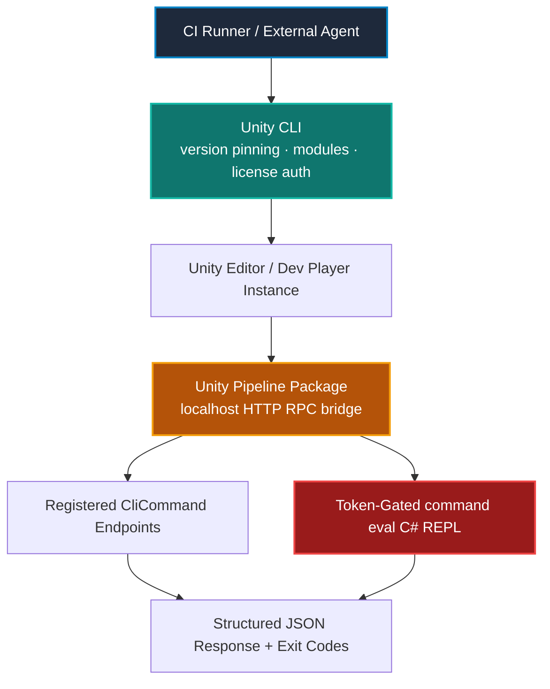

## What Makes the Unity Editor a Dependable CI and Agent Surface?

The most expensive failure mode in game development pipelines rarely stems from code compilation errors. It originates in human and configuration ambiguity surrounding the local editor instance: mismatched editor patch versions, missing target platform support modules, unverified scene states, and tests executed against unobservable GUI states. When CI automation or an autonomous coding agent attempts to build, test, or inspect a Unity project, traditional graphical tools force operators to rely on brittle mouse-and-keyboard automation or unverified console output scraped from unstructured log files.

To turn the Unity Editor into a deterministic, machine-readable harness, Unity introduced the standalone **Unity CLI** and the experimental **Unity Pipeline package** (`com.unity.pipeline`). Together, they bridge developer intent, external CI runners, and local agent harnesses. The fundamental engineering requirement is separating host environment provisioning from live project execution.



By decoupling editor lifecycle management from runtime scene interaction, studios can enforce verifiable boundaries across development pipelines:

| Architecture Layer | Core Responsibility | Production Guardrail |
|---|---|---|
| **Unity CLI** (`unity`) | Editor binaries, target modules, project discovery, licensing | Pin exact minor/patch versions; demand `--format json`. |
| **Unity Pipeline** (`com.unity.pipeline`) | Localhost RPC socket to running Editor or Player | Keep endpoints bound to `127.0.0.1`; dev builds only. |
| **Registered `CliCommand`** | Project-specific actions with typed arguments | Explicit input validation and atomic return values. |
| **Dynamic `command eval`** | Interactive C# Roslyn inspection in live sessions | Token authentication required; never ship in release Player. |

---

## Machine-Readable Automation Contracts with the Unity CLI

The baseline utility of `unity` is eliminating manual Unity Hub interactions in cloud runners and ephemeral container environments. Rather than guessing whether an agent or build runner has the necessary Android NDK or WebGL build modules, the CLI exposes structured query interfaces.

When designing robust CI workflows, output must be consumed as an automation contract rather than terminal decoration. The CLI returns standard POSIX exit codes (`0` for success, `1` for execution failures, and `130` for user termination) while strictly isolating payload results on `stdout` and diagnostic logs on `stderr`.

```bash
#!/usr/bin/env bash
# ci/verify-editor-environment.sh
set -euo pipefail

REQUIRED_EDITOR="6000.2.10f1"
REQUIRED_MODULES=("android" "ios" "webgl")

echo "Querying installed Unity editors..."
INSTALLED_JSON="$(unity editors --installed --format json)"

if ! jq -e --arg ver "$REQUIRED_EDITOR" '.[] | select(.version == $ver)' <<<"$INSTALLED_JSON" >/dev/null; then
  echo "Error: Required Editor $REQUIRED_EDITOR is missing. Provisioning now..." >&2
  unity install "$REQUIRED_EDITOR" -m "${REQUIRED_MODULES[@]}" --accept-eula --yes --format json
fi

echo "Verifying active license and configuration..."
unity doctor --format json > /tmp/unity-doctor-report.json
echo "Host runner verified for $REQUIRED_EDITOR."
```

By passing `--format json` explicitly, shell scripts and agent tools avoid the fragile regex scraping historically required when parsing Unity Hub text tables or ANSI progress bars. This mirrors the headless operational model explored in our analysis of [Atomic Agent and headless Unity builds](/posts/unity-cli-atomic-agent/), where build jobs execute without human intervention.

---

## Controlled In-Editor Tooling via Registered `CliCommand`

Once the host environment is provisioned, orchestrating an open Editor instance requires a safe interface. Opening and closing an Editor project for every minor unit test or asset audit wastes minutes in recompilation and domain reloading. The `com.unity.pipeline` package resolves this by listening on a localhost socket for authorized remote procedure calls.

Instead of granting external scripts arbitrary code execution, production architectures register typed, discoverable commands using the `[CliCommand]` attribute. This encapsulates internal engine mutations within controlled boundaries.


```csharp
// Assets/Editor/BuildPipelineCommands.cs
using System;
using Unity.Pipeline.Commands;
using UnityEditor;
using UnityEngine;

public static class BuildPipelineCommands
{
    [CliCommand("audit-scene-lighting", "Validates baked lightmaps and probe anchors across active scene.")]
    public static string AuditSceneLighting(
        [CliArg("max-unbaked-mesh", "Tolerated unbaked mesh count", Required = false)] int maxUnbaked = 0)
    {
        var renderers = UnityEngine.Object.FindObjectsByType<MeshRenderer>(FindObjectsSortMode.None);
        int unbakedCount = 0;

        foreach (var mr in renderers)
        {
            if (mr.receiveGI == ReceiveGI.Lightmaps && mr.lightmapIndex == -1)
            {
                unbakedCount++;
            }
        }

        if (unbakedCount > maxUnbaked)
        {
            throw new InvalidOperationException(
                $"Lighting audit failed: found {unbakedCount} unbaked static meshes (tolerance: {maxUnbaked}).");
        }

        return $"{{\"status\":\"success\",\"unbaked_count\":{unbakedCount}}}";
    }
}
```


Once recompiled, external harnesses discover and trigger this operation directly:

```bash
# Discover all registered commands on the active project
unity command --project-path="$(pwd)"

# Execute the specific lighting validation command
unity command audit-scene-lighting --max-unbaked-mesh 5 --project-path="$(pwd)"
```

The advantage over legacy `-executeMethod` command-line flags is substantial: the Editor remains warm, domain reloading occurs only when source files change, and failures yield structured JSON responses rather than requiring log-file traversal.

---

## Token-Gated Dynamic Evaluation and Live QA Diagnostics

For exploratory debugging and agentic problem-solving where pre-registered commands are insufficient, `unity command eval` provides an interactive Roslyn-powered C# REPL targeting the Editor main thread.

```bash
# Read live engine properties securely
unity command eval "return UnityEngine.Application.unityVersion;" --format json

# Inspect runtime Play-mode state
unity command eval "return UnityEditor.EditorApplication.isPlaying;" --format json

# Query active memory consumption on development targets
unity command eval "return UnityEngine.Profiling.Profiler.GetTotalAllocatedMemoryLong();" --format json
```

To prevent local privilege escalation and rogue network exploitation:
1. **Localhost Confinement**: The pipeline server binds exclusively to `127.0.0.1` and rejects external interface traffic.
2. **Security Token Exchange**: Each session requires an ephemeral token negotiated via the CLI, preventing unauthorized local applications from issuing commands.
3. **Player Runtime Stripping**: Runtime Player evaluation requires explicit compilation defines; release builds strip `com.unity.pipeline` symbols entirely.

This controlled introspection enables multi-turn agent harnesses to verify whether an asset tweak or shader adjustment actually produced the intended state in a running instance, connecting cleanly with the protocol patterns discussed in [Model Context Protocol and agentic infrastructure](/posts/mcp-roadmap-agentic-infrastructure/).

---

## Progressive Rollout Matrix for Automated Game Engineering

Adopting command-line game automation requires incremental security and stability boundaries:

| Phase | Milestone Artifact | Verification Metric | Operational Boundary |
|---|---|---|---|
| **Phase 1: Environment Reproducibility** | Dockerfile / CI bootstrap script | `unity editors --format json` matches exact commit spec | Zero GUI dependency for toolchain installation |
| **Phase 2: Project Pipeline Bridge** | `manifest.json` includes `com.unity.pipeline` | `unity command` lists available project endpoints | Localhost socket only; Unity 6.0+ LTS baseline |
| **Phase 3: Bounded In-Editor Tools** | Custom `[CliCommand]` suites | Tests emit JSON results with distinct exit codes | Full argument validation and fail-closed error handling |
| **Phase 4: Agentic QA Introspection** | Token-gated `eval` diagnostic routines | Non-reloading telemetry captured during Play mode | Development and test runner machines only |

---

## What Changed Since the July 2026 Beta Announcement

When the Unity CLI was initially announced in July 2026, the ecosystem faced three major limitations that have evolved over subsequent patch cycles:

1. **Experimental CLI Maturity**: Early builds had incomplete module resolution flags on Linux ARM64 runners. Current releases stabilize headless authentication via headless service tokens, making containerized cloud runners fully reproducible without GUI auth workarounds.
2. **Roslyn Compilation Overhead in `eval`**: The initial implementation incurred high latency on cold C# expression evaluation due to full compilation passes. Pipeline updates incorporate cached compilation contexts, reducing query latency from ~800ms down to sub-100ms for continuous state polling.
3. **Integration with Agent Tool Protocols**: The shift toward standardized tool interfaces (like MCP) has positioned the CLI and Pipeline package as backends for agent development tools, allowing autonomous agents to query hierarchy trees and trigger asset baking without direct Editor focus.

---

## Key Takeaways

- **Strict Separation of Concerns**: Unity CLI manages binaries, licenses, and target platform modules on the host system; the Unity Pipeline package manages in-editor communication over a secure localhost socket.
- **Fail-Closed Automation Contracts**: Using `--format json` alongside POSIX exit codes turns opaque engine logs into machine-verifiable pipeline artifacts suitable for CI runners.
- **Prefer Typed Commands Over Open REPLs**: Registered `[CliCommand]` handlers provide bounded, reviewable mutation interfaces. Use `unity command eval` strictly for diagnostic inspection and temporary QA checks.
- **Never Ship Pipeline Code**: Ensure `com.unity.pipeline` and any associated diagnostic commands are excluded from release Player builds to avoid exposing internal endpoints.

---

## Open Questions

- How will Unity manage multi-instance concurrency when multiple automated test runners or agent processes attempt to address distinct projects simultaneously on a single workstation?
- Will future releases of the Unity Pipeline support native MCP (Model Context Protocol) tool declarations directly, eliminating the need for wrapper CLI adapters in autonomous agent systems?
- What are the memory and domain-reloading overhead limits when keeping long-running Editor instances alive across hundreds of consecutive automated pipeline invocations?

---

## References

- [Unity Technologies: Meet the Unity CLI](https://unity.com/en/blog/meet-the-unity-cli) — official announcement and architectural overview of `unity` and `com.unity.pipeline`, July 20, 2026 (re-read 2026-10-17).
- [Unity CLI Reference & Command Inventory](https://docs.unity.com/en-us/unity-cli/unity-cli-reference) — detailed documentation of subcommands, exit codes, JSON outputs, and environment flags (accessed 2026-10-17).
- [Unity Production Pipeline Documentation](https://docs.unity.com/en-us/unity-production-pipeline/local-tools-cli/unity-pipeline-package) — setup prerequisites, `CliCommand` attributes, and security requirements for Editor version 6.0+ (accessed 2026-10-17).
- [Unity Hub & Headless Licensing Manual](https://docs.unity.com/hub/en-us/manual/hub-headless.html) — reference for non-interactive service-account authentication in CI runners (accessed 2026-10-17).
