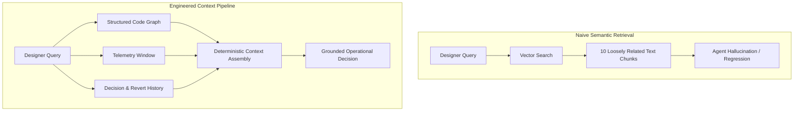
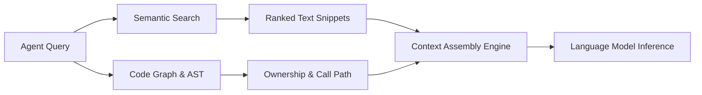

> This Source Audit inspects the boundary between language model system prompts and operational context engineering in live-ops production. It grounds retrieval in Sourcegraph's context design principles, MemGPT working-context mechanics, and NeurIPS 2025 A-Mem associative memory structures.
{: .prompt-info}

## Why Coherent Agents Fail on Live-Ops Workflows

A common failure mode in autonomous production agents is not flawed deductive logic or insufficient parameter count, but contextual blindness. Consider an automated live-ops assistant assigned to evaluate gameplay patch proposals: the agent has complete access to repository commits, raw game telemetry exports, and an unindexed vector store of design documentation. When tasked with recommending balance tuning for an over-performing ability, it confidently proposes cooldown reductions that had already been shipped, evaluated, and subsequently reverted two patches earlier due to player retention regressions.



The agent was not hallucinating syntax or misunderstanding the prompt; its internal reasoning remained completely coherent. The critical operational fact—the prior revert and its causal telemetry signature—never entered the agent's inference context window.

This gap exposes why prompt engineering alone fails at scale. Prompt engineering governs how a model processes tokens, while **context engineering** governs the deterministic pipeline that decides which tokens enter the context window in the first place. For multi-step autonomous workflows such as those analyzed in our audits of [/posts/superlog-agentic-telemetry/](/posts/superlog-agentic-telemetry/) and [/posts/unity-cli-atomic-agent/](/posts/unity-cli-atomic-agent/), durable state requires deliberate retrieval and memory architectures.

## Structuring the Four Layers of Agent Context Engineering

A production-ready context engineering architecture consists of four distinct operational layers: retrieval, memory, assembly, and reasoning scaffolds. Treating these as a monolithic prompt leads to unpredictable context pollution.

| Architecture Layer | Core Function | Typical Production Failure | Engineering Mitigation |
|:---|:---|:---|:---|
| **Retrieval** | Discovering relevant external state | Vector similarity returning keyword collisions without code ownership | Structured AST code graphs + symbol ownership |
| **Memory** | Distinguishing session turns from durable history | Unbounded chat history saturating context windows | Structured event schemas with explicit invalidation TTL |
| **Assembly** | Ordering and budgeting tokens by relevance | Recency bias pushing critical constraints out of window | Explicit budget allocation and uncertainty flags |
| **Reasoning Scaffolds**| Enforcing procedural verification before execution | Models acting immediately on top-ranked retrieval matches | Pre-flight verification gates and guardrail schemas |

### 1. Retrieval: Code Graphs Over Plain Vector Search

In software and game engine development, plain vector retrieval frequently fails. Querying an embedding index for `cooldown` might return dozens of parameter mentions across player controllers, UI displays, and localization files. None of those embeddings indicate which C# component owns the value, which configuration asset reaches the release build, or which telemetry event tracks its runtime impact.



Structured code intelligence provides exact symbol relationships: call graphs, component ownership, inheritance trees, and asset references. The retrieval stage must answer not merely where a keyword exists, but which exact execution path changes observable game behavior.

### 2. Memory: Separating Working Sessions from Durable State

Memory design requires strict separation between transient session state and durable cross-session history:

- **Short-Term Working Memory:** Contains current conversational turns, intermediate tool invocation payloads, and immediate loop state. It lives exclusively inside the prompt context and is pruned or discarded at session boundaries.
- **Long-Term Durable Memory:** Records architectural decisions, historical post-mortems, verified bug root causes, and explicit design constraints.

Storing raw conversation logs as long-term memory degrades retrieval over time. It inflates token budgets and forces subsequent runs to ingest irrelevant historical chatter. As demonstrated in associative memory research, durable facts should be distilled into structured events: what was modified, which metrics were affected, and under what conditions the fact must be invalidated.

### 3. Context Assembly: Relevance and Freshness Over Recency

The most insidious context failure is recency bias. When an agent context window is assembled chronologically, the most recent twenty tool executions dominate the window, while foundational architecture rules defined in turn 1 or historical rollback constraints are pushed out or truncated.

Deterministic context assembly requires explicit priority budgeting:
1. **System Directives & Machine Interfaces:** Invariant schemas and operating bounds.
2. **Deterministic Constraint Rules:** Explicit design boundaries and known rollback flags.
3. **Structured Code & Telemetry Evidence:** Ranked AST paths and dated telemetry cohorts.
4. **Distilled Long-Term State:** Historical decisions matching the current subsystem.
5. **Recent Operational Window:** The minimal set of immediate turns required to ground current intent.

### 4. Reasoning Scaffolds: Verification Before Mutation

A reasoning scaffold enforces operational verification before an agent is permitted to invoke state-mutating tools. Rather than allowing a model to immediately execute a code edit upon retrieving a document, the scaffold demands explicit intermediate assertions: validating constraint satisfaction, checking prior rollbacks, and running automated test suites.

## Implementing a Deterministic Balance-Review Guardrail

To illustrate this architecture in practice, consider an automated balance-review guardrail implemented in Python. Rather than exposing an open-ended conversational prompt, the system compiles a typed `BalanceContext` payload that isolates facts across subsystems:

```python
from dataclasses import dataclass
from typing import Any, Dict, List

@dataclass(frozen=True)
class BalanceContext:
    system_id: str
    target_lever: str
    code_ownership: Dict[str, Any]
    telemetry_window_30d: Dict[str, float]
    historical_reverts: List[Dict[str, str]]
    active_patch_constraints: List[str]

def assemble_verified_context(
    proposal: Dict[str, str],
    decision_store: Any,
    code_graph: Any,
    telemetry_client: Any,
) -> BalanceContext:
    system = proposal["subsystem"]
    lever = proposal["parameter"]

    # Deterministic multi-source gathering
    return BalanceContext(
        system_id=system,
        target_lever=lever,
        code_ownership=code_graph.trace_ownership(system),
        telemetry_window_30d=telemetry_client.get_cohort_metrics(system, window_days=30),
        historical_reverts=decision_store.query_reverts(system=system, parameter=lever),
        active_patch_constraints=decision_store.get_global_constraints(active_only=True),
    )
```

By packaging inputs into an explicit typed data structure, the agent cannot bypass historical revert checks. If `historical_reverts` contains entries, the reasoning scaffold prompts the agent to provide explicit falsification criteria before recommending another adjustment to that parameter.

```mermaid
sequenceDiagram
    autonumber
    actor Designer
    participant Harness as Context Harness
    participant CodeDB as Code Graph AST
    participant HistDB as Revert Ledger
    participant LLM as Agent Model

    Designer->>Harness: Submit Tuning Proposal (Cooldown -15%)
    Harness->>CodeDB: Trace Ownership & Call Graph
    CodeDB-->>Harness: C# Component & Asset Binding
    Harness->>HistDB: Query Historical Decisions
    HistDB-->>Harness: Prior Revert Detected (Patch 7.5 Regression)
    Harness->>LLM: Assemble Verified Context + Conflict Challenge
    LLM-->>Designer: Reject/Flag: Prior Revert on Record; Requires Regression Test
```

## What Changed Since 2024: From Monolithic Contexts to MCP

In early 2024, agent memory was commonly conceptualized as an expansive vector database where all conversation turns, documentation, and source code were embedded into a single shared space. This pattern suffered from severe operational defects: semantic collisions, inability to invalidate stale facts, and complete blindness to codebase structure.

Between 2024 and 2026, the industry transitioned toward structured, protocol-driven context systems. The widespread adoption of the Model Context Protocol (MCP) transformed context retrieval from bespoke internal Python shims into standardized client-server interfaces. An agent today does not rely on monolithic semantic search; it negotiates with specialized MCP servers exposing AST analyzers, telemetry databases, and issue trackers as first-class tools.

Furthermore, context window sizes expanded to millions of tokens, paradoxically increasing the necessity of context engineering. Large windows suffer from the "needle in a haystack" degradation curve: injecting hundreds of thousands of unranked tokens increases latency, elevates inference cost, and amplifies attention distraction. Precision context assembly remains more critical than brute-force window expansion.


<figure class="source-image">
  
  <figcaption>MemGPT Figure 2 shows recall_storage.search returning earlier conversation records and the agent using a relevant fact in its response. Source: <a href="https://arxiv.org/html/2310.08560v2">Charles Packer et al.</a>. MemGPT Figure 2, CC BY 4.0; original diagram, metadata stripped. Licence: <a href="https://creativecommons.org/licenses/by/4.0/">CC BY 4.0</a>.</figcaption>
</figure>

<figure class="source-image">
  
  <figcaption>MemGPT Figure 1 shows a memory-pressure alert followed by a working-context append. Source: <a href="https://arxiv.org/html/2310.08560v2">Charles Packer et al.</a>. MemGPT Figure 1, CC BY 4.0; original diagram, metadata stripped. Licence: <a href="https://creativecommons.org/licenses/by/4.0/">CC BY 4.0</a>.</figcaption>
</figure>

<figure class="source-image">
  
  <figcaption>MemGPT Figure 4 shows an existing memory being corrected when the conversation supplies changed information. Source: <a href="https://arxiv.org/html/2310.08560v2">Charles Packer et al.</a>. MemGPT Figure 4, CC BY 4.0; original diagram, metadata stripped. Licence: <a href="https://creativecommons.org/licenses/by/4.0/">CC BY 4.0</a>.</figcaption>
</figure>

<figure class="source-image">
  
  <figcaption>A-Mem Figure 2 connects structured note attributes, links between memories, memory evolution, and query-based retrieval. Source: <a href="https://proceedings.neurips.cc/paper_files/paper/2025/hash/19909c36f51abc4856b4560aff3d36d6-Abstract-Conference.html">Wujiang Xu et al.</a>. A-Mem Figure 2, CC BY 4.0; rasterized from PDF. Licence: <a href="https://creativecommons.org/licenses/by/4.0/">CC BY 4.0</a>.</figcaption>
</figure>

## Key Takeaways

| Principle | Engineering Implication | Verification Check |
|:---|:---|:---|
| **Context Precedes Prompting** | The accuracy of agent outputs is bounded by context quality rather than prompt phrasing | Audit assembled context tokens before modifying system prompt instructions |
| **Graph Structure Over Plain Embeddings** | Code and configuration require relational AST awareness | Verify call graphs and component ownership alongside semantic similarity search |
| **Strict Memory Tiering** | Unbounded raw history pollutes long-term decision making | Distill operational facts into structured schemas with explicit invalidation triggers |
| **Deterministic Token Budgeting** | Recency bias displaces foundational architectural constraints | Implement strict section budgets within the context assembly pipeline |

## Open Questions

- What deterministic invalidation protocols best handle live-ops game code where game design balance values change on weekly cadences?
- How can distributed multi-agent systems negotiate write locks and avoid race conditions when updating shared long-term memory graphs?
- What lightweight evaluation harnesses can reliably benchmark context assembly quality without incurring the full latency and cost of downstream agent execution?

## References

- Charles Packer, Sarah Wooders, Kevin Lin, Vivian Fang, Shishir G. Patil, Ion Stoica, and Joseph E. Gonzalez. *MemGPT: Towards LLMs as Operating Systems*. arXiv:2310.08560v2 [cs.AI], 2023. Pinned version: [https://arxiv.org/abs/2310.08560v2](https://arxiv.org/abs/2310.08560v2). (Re-read and audited 2026-10-17).
- Wujiang Xu, Zujie Liang, Kai Mei, Hang Gao, Juntao Tan, and Yongfeng Zhang. *A-Mem: An Associative Memory Architecture for AI Agents*. NeurIPS 2025 Conference Proceedings. Pinned version: [https://proceedings.neurips.cc/paper_files/paper/2025/hash/19909c36f51abc4856b4560aff3d36d6-Abstract-Conference.html](https://proceedings.neurips.cc/paper_files/paper/2025/hash/19909c36f51abc4856b4560aff3d36d6-Abstract-Conference.html). (Re-read and audited 2026-10-17).
- Sourcegraph. *Context Engineering for Coding Assistants*. Technical Report and Architecture Guide. Pinned URL: [https://sourcegraph.com/blog/context-engineering](https://sourcegraph.com/blog/context-engineering). (Re-read and verified 2026-10-17).
- Model Context Protocol (MCP) Specification. *Protocol Overview and Architecture*. Anthropic & Open Source Working Group, 2026. Pinned URL: [https://modelcontextprotocol.io/specification](https://modelcontextprotocol.io/specification). (Re-read and verified 2026-10-17).
