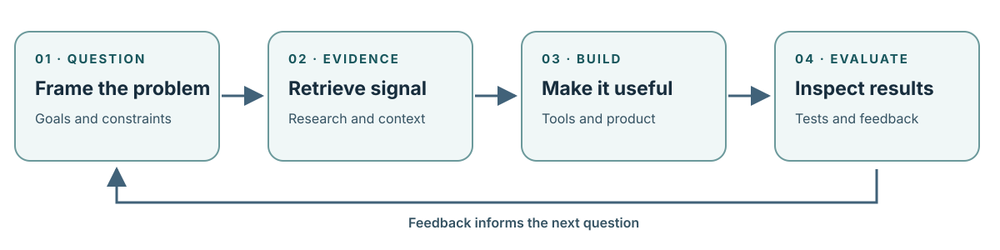

---
# the default layout is 'page'
icon: fas fa-info-circle
order: 5
mermaid: false
---

<section class="about-hero" aria-labelledby="about-intro-title">
  

    
A ROADMAP FROM GAMES TO AI PRODUCTS

    <h2 id="about-intro-title">Building useful AI, one milestone at a time.</h2>
    
I'm <strong>Jang Young Jeong</strong> (Fodev JEO). My path connects game systems, research, and practical AI products.

    
Based in Hwaseong, Gyeonggi-do, South Korea

    

      <a class="about-button about-button--primary" href="#selected-work">Explore the roadmap →</a>
      <a class="about-button about-button--secondary" href="/contact/">Get in touch ↗</a>
    

  

  <figure class="about-hero__art">
    
    <figcaption>Concept illustration generated with GTI; not an actual workspace.</figcaption>
  </figure>
</section>

  
RECENT ROLE<strong>Supercent</strong><small>AI Product Developer · 2025–2026</small>

  
RESEARCH<strong>Hongik University</strong><small>Ph.D. candidate · Game Engineering</small>

  
FOUNDATION<strong>8 years in games</strong><small>NCSOFT + Com2uS</small>

<nav class="about-jump" aria-label="On this page">
  EXPLORE
  <a href="#selected-work">Roadmap</a>
  <a href="#what-i-build-now">What I build</a>
  <a href="#open-source">Open source</a>
  <a href="#editorial-method-and-ai-assistance">Editorial method</a>
</nav>

---

### How I connect research to product work

I started in games because games force systems to be interactive, measurable, and brutally honest. If the AI is weak, players feel it. If the pipeline is slow, the team feels it. That environment shaped how I still build today.

My work began with game AI, procedural systems, digital humans, and computer-vision-based QA. Over time, that naturally expanded into a broader question: how do you turn research and experimentation into AI products people can actually use? That question is what now drives my work as an AI product engineer.

{: .w-100 }

The loop is **question → evidence → build → evaluate**. Evaluation feeds the next question; the diagram is a conceptual model, not a claim that every project followed the same sequence.

---

### What I Build Now

I am currently focused on AI products that need more than a good demo. I care about systems that can use tools, work with multimodal inputs, stay inspectable under failure, and improve through evaluation rather than intuition alone.

In my Supercent role (Dec 2025 - Sep 2026), I designed and shipped end-to-end AI products on top of multimodal-embedding RAG and agentic workflows. Two examples are internal Firebase/Genkit SaaS platforms I built in weeks:

- **SAGA** — a game-studio "AI brain": a RAG search engine over game design docs using RAG-Fusion, CRAG, hybrid search, Cross-Encoder reranking, and a Grounding-Guardian generation pattern, indexing 594 documents / 1,563 vectors across 15 games.
- **Millie** — a per-user RAG assistant plus a Slack-bot-driven, local-LLM "ClawTeam" autonomous-agent system, with an admin control hub for knowledge sources (Notion/Drive/Calendar), credentials, agent assignment, and LLM call-quality monitoring.

Beyond shipped products, I spend time on problems like:

- agent workflows that combine reasoning, tool use, and clear product boundaries
- multimodal QA pipelines that read gameplay, images, or video and turn them into useful reports
- harness engineering, tracing, and human-in-the-loop checks for agent reliability
- product surfaces where AI feels legible, not magical
- the overlap between interactive systems, wellness, robotics, and AI-native user experiences

---

### Why This Path Makes Sense

My background is not separate from this work. It is the reason I fit it.

At NCSOFT and Com2uS, I worked on game AI, balancing agents, procedural generation, and automation problems where feedback loops were tight and product quality mattered every day. In graduate research, I kept moving toward systems that observe what happened on screen, interpret it, and generate useful action from it. That line continues directly into current work on AI products, agents, and multimodal workflows.

The common thread is simple: build systems that can perceive context, make useful decisions, and help teams move faster without losing control.

---

### Current Direction

My current focus builds on that shift from specialized game AI into broader AI product development. In my recent Supercent role (Dec 2025 - Sep 2026), I owned internal AI products from concept to operation, improved reliability and discoverability, and helped establish AI-native collaboration standards used by product teams. My current interests include context engineering, harness engineering, MCP-connected tools, local and open-model experiments, and practical multi-agent orchestration.

I am especially interested in the part of the ecosystem that is becoming more real and less theoretical:

- production agent stacks built around tools, tracing, and evals
- MCP as a standard way to connect models to tools, data, and workflows
- A2A-style interoperability for agent-to-agent collaboration
- interfaces that keep human review in the loop for higher-risk actions

I prefer starting with one capable agent and adding orchestration only when the problem truly earns the extra complexity.

---

### Open Source

I build and maintain agent-tooling projects in public. Each project has a different role; installing a skill or using a gate is not a guarantee of a correct outcome.

  <a class="about-project" href="https://github.com/akillness/jeo-code">CODING AGENT<strong>jeo-code ↗</strong>
Bun-based agent with multi-provider tools and anchored edits.
</a>
  <a class="about-project" href="https://github.com/akillness/jeopi">AGENT RUNTIME<strong>jeopi ↗</strong>
An oh-my-pi fork with a spec-first, critic-gated workflow.
</a>
  <a class="about-project" href="https://github.com/akillness/jeo-skills">SKILL CATALOG<strong>jeo-skills ↗</strong>
Discover and install reusable instructions for coding agents.
</a>
  <a class="about-project" href="https://github.com/akillness/oh-my-jeo">WORKFLOW PACK<strong>oh-my-jeo ↗</strong>
Spec-first workflows and contracts for chat agents.
</a>
  <a class="about-project" href="https://github.com/akillness/jeo-claw">ORCHESTRATION<strong>jeo-claw ↗</strong>
Discord-controlled agentic repository workflows.
</a>

---

### Selected Work

From game development to research and AI products: these milestones summarize work already undertaken. Research and industry roles overlap; the final stop describes current interests, not a promised release schedule.

<ol class="about-roadmap" aria-label="Career roadmap and milestones">
  <li class="about-roadmap__stop">
    
01

    
FOUNDATION · GAMES<h4>Interactive systems in production</h4>
At Com2uS and NCSOFT, I worked on game programming, AI agents, procedural generation, and internal tools.
GAME AI &amp; AUTOMATION

  </li>
  <li class="about-roadmap__stop">
    
02

    
2024–PRESENT · RESEARCH<h4>Game engineering at Hongik University</h4>
Ph.D. research explores game QA automation, visual understanding, and agentic workflows alongside industry work.
MULTIMODAL QA

  </li>
  <li class="about-roadmap__stop">
    
03

    
JUL–DEC 2025 · SK INTELIX<h4>AI for connected products</h4>
At SmartHome Tech, I worked on AI feature compliance, TTS/STT collaboration, and a device-monitoring frontend.
PRODUCT &amp; DEVICE UX

  </li>
  <li class="about-roadmap__stop">
    
04

    
DEC 2025–SEP 2026 · SUPERCENT<h4>From retrieval to internal AI products</h4>
I worked on SAGA and Millie, internal Firebase/Genkit platforms using RAG and agentic workflows.
RAG &amp; AGENT WORKFLOWS

  </li>
  <li class="about-roadmap__stop about-roadmap__stop--current">
    
05

    
CURRENT DIRECTION · EXPLORING<h4>More inspectable AI systems</h4>
Current interests include evaluation, context engineering, MCP-connected tools, and human review for higher-risk actions.
<a href="#open-source">Explore the open-source projects →</a>

  </li>
</ol>

**Recent research and publications**

- IEEE RAAI 2024 poster on image-based game QA automation
- 2025 publication on automated game QA reporting based on natural language captions
- patents in emotional computing and game difficulty determination

**Previous industry path**

- AI Programmer, NCSOFT (match-3 difficulty agents, CA/GAN level generation, 4D digital human pipelines)
- Game Programmer, Com2uS (DQN reinforcement-learning prototypes, Unity↔Python socket systems, internal tooling)

This path gave me a strong bias toward systems that are measurable, iterative, and useful under real constraints.

---

### How I Work

- I prototype early to learn where the real constraints are.
- I use research to sharpen direction, not to avoid shipping.
- I treat evaluation, traces, and failure analysis as product work, not cleanup.
- I care about clear interfaces because trust in AI systems is a UX problem as much as a model problem.
- I like fast feedback loops, small experiments, and systems that get better with use.

### Editorial Method and AI Assistance

I am accountable for this publication and its editorial rules. AI tools assist research, drafting, translation, diagrams, and code review; their output is not evidence. Scheduled source audits may publish under a standing, evidence-gated policy after independent evidence review and automated checks, without a separate human approval for each page. That review is not a claim that I personally performed every check. Technical claims should point to primary documentation, pinned source code, runnable checks, or dated measurements. Unsupported claims are removed or marked as opinion or limitation. This section is the single, site-wide disclosure of that method; individual articles link here instead of repeating a disclaimer.

What a reader can expect from every current article (editorial standard updated 2026-10-14):

- **A finding, not a paraphrase.** Each source audit reads a pinned commit, release, paper version, or documentation page and reports something the source does not say about itself: a behavior, a contradiction, a measurement, or a decision boundary. Summaries, translations, or stitched material without added analysis are not published.
- **Headings that say what they contain.** Section headings name the question and the findings in plain words. There is no reusable template skeleton, and the same claim is never spread across multiple pages to target search variations.
- **Maintained structure.** Articles live in three category axes (`AI, Agents`, `AI, Research`, `AI, Tooling`); thin tag and category archives are not generated. An article that stops meeting the standard is improved or leaves search and advertising together, and material corrections carry a dated correction notice.
- **Measured cadence.** At most one scheduled article is published per run, on Tuesday and Friday, and a run publishes nothing when no candidate clears the evidence gates.

New source audits follow the evidence-gated standard above. On 2026-10-12 I approved a separate, bounded restoration of 283 historical reference notes to public search. Their original publication dates are retained and advertising remains disabled on every note that still carries the archive notice. This archive exception is not a claim that every historical statement was freshly fact-checked or rewritten. Since 2026-10-14 those notes are being rebuilt one at a time: each rebuilt article re-reads its primary sources, states what changed since the original date, carries a dated rebuild note at the top, and only then leaves the archive exception. Notes that cannot be rebuilt honestly are withdrawn from search instead. On 2026-11-05 I applied that rule to 225 of the 273 notes that had been marked rebuilt, because the rebuild ledger holds no per-post record of the primary sources re-read for them (214 of them were processed in a single batch on 2026-10-18). Together with 10 notes withdrawn earlier, 235 of the 283 notes are now out of search, the sitemap, and advertising; the other 48 rebuilt articles stay indexed because their ledger entries name what was re-read or a dated correction audit covers them. Outside this exact restored cohort, notes without sufficient original analysis are removed from search and advertising. The five existing search-excluded notes remain excluded. Corrections can be reported through [Contact](/contact/) or the public Git history. A dated correction notice identifies the scope of a material correction. It does not mean every other claim was re-reviewed. Repository change dates can also include metadata maintenance, so they should not be read as independent source-review dates.

---

### Personal Activity

Outside formal work, I actively write and experiment in public.

- I run this AI tech blog as a place to connect research, tooling, and product practice.
- I have been exploring wellness, robotics, and AI through Wellflix and adjacent personal projects.
- I regularly study and document topics like Claude Code, Codex, context engineering, MCP, ACP, LSP, harness engineering, and long-running agent workflows.
- I also build and test multi-agent prototypes with local models, semantic routing, query expansion, and retrieval-heavy workflows.

This site is where those threads come together.

---

### Tech I Reach For

| Area | Tools and themes |
|:--|:--|
| Languages and ML | Python, C, C++, C#, Dart, PyTorch, TensorFlow, Transformers, OpenCV |
| AI stack | LangGraph, LlamaIndex, RAG, Qdrant, ColBERT, PEFT/LoRA, ONNX, MCP |
| Product and infrastructure | Docker, Linux, GCP, AWS, Firebase, Genkit, WebSocket, PyQt, Flutter |
| Current themes | Agents, MCP, A2A, evals, tracing, multimodal QA, tool use, product engineering |

---

### Links

- [Portfolio guide](/projects/)
- [Contact](/contact/)
- [Visual portfolio](/portfolio/)
- [Resume](/resume_eng/)
- [LinkedIn](https://www.linkedin.com/in/akillness38/)
- [GitHub](https://github.com/akillness)
- [AI Tech Blog](https://akillness.github.io)
- [Naver Blog (Korean edition)](https://blog.naver.com/akillness)

If you are building AI products that need to be grounded in real workflows, multimodal inputs, or interactive systems, I am always interested in comparing notes.
